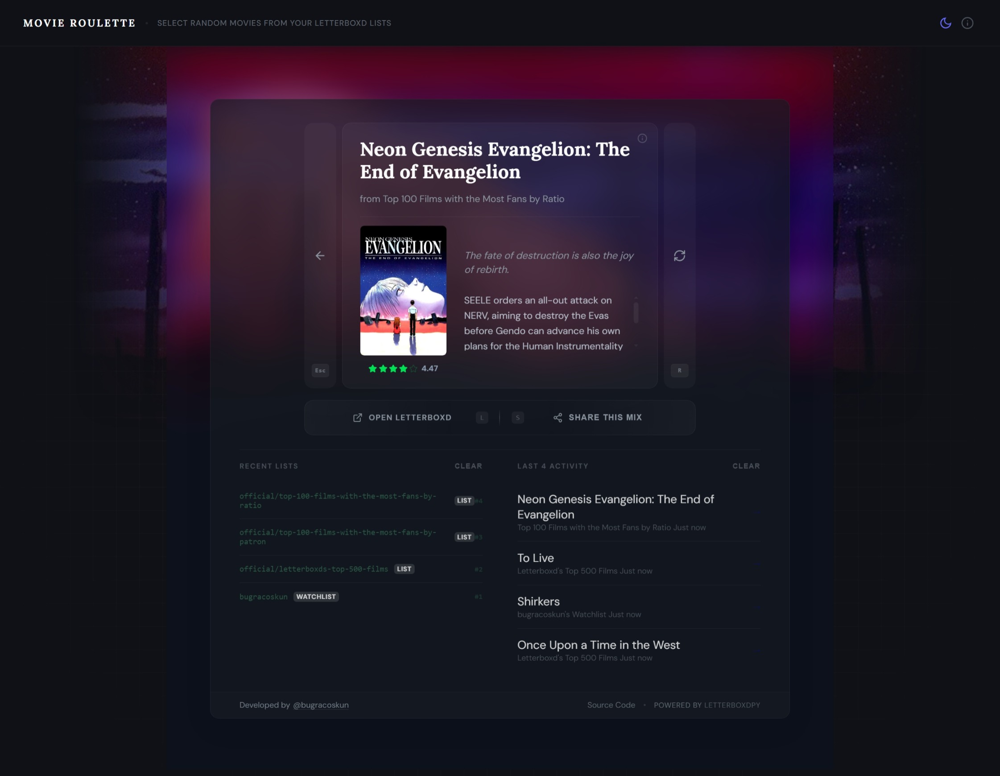

# Movie Roulette

[](https://roulette.bugra.co)


A fast, modern web application and direct redirect engine to pick a random movie from Letterboxd lists: **[roulette.bugra.co](https://roulette.bugra.co)**

> [!NOTE]
> Movie Roulette extracts public list metadata and film details via [letterboxdpy](https://github.com/nmcassa/letterboxdpy) without requiring Letterboxd API access tokens.

<p align="center">
  <picture>
    <source media="(prefers-color-scheme: dark)" srcset=".github/assets/movie-roulette-dark.jpeg">
    <source media="(prefers-color-scheme: light)" srcset=".github/assets/movie-roulette-light.jpeg">
    
  </picture>
  <br>
  <sub><a href=".github/assets/movie-roulette-dark.jpeg" target="_blank">Dark Mode</a> | <a href=".github/assets/movie-roulette-light.jpeg" target="_blank">Light Mode</a></sub>
</p>

---

## Key Features

- **Multi-List Aggregation:** Combine up to 5 Letterboxd watchlists and custom lists simultaneously into a single pool.
- **Dual Randomization Engines:**
  - **Deep Sample (Default):** Statistically uniform sampling across all pages of large lists, ensuring older entries have equal odds as recent additions.
  - **Fast Shuffle:** Utilizes Letterboxd native `/by/shuffle/` sorting for fast, single-request picks on watchlists and lists.
- **Proportional vs. Equal Odds:** Choose between weighting movie probability proportionally by list size or giving each list equal selection chances.
- **Server-Side Direct Redirect (`/r`):** Instantly redirect directly to a Letterboxd movie page without downloading frontend HTML, CSS, JavaScript, or web fonts.
- **Automation and Headless Output:** Pass `format=json` or request `Accept: application/json` on redirect routes for iOS Shortcuts, Raycast extensions, and CLI scripts.
- **Rich Movie Overviews:** Displays high-resolution posters, backdrop banners, community ratings, genres, directors, top cast members, and taglines.
- **Real-Time Validation:** Automatic detection for private lists, empty watchlists, 404 targets, and duplicate lists with visual field error badges.
- **Modern Design:** Zero external CSS frameworks, bespoke high-contrast Dark and Light themes with system auto-detection, and keyboard navigation.

---

## Server-Side Direct Redirect (`/r`)

Movie Roulette provides a direct backend redirection engine. When hitting redirect endpoints, the server resolves the list, selects a random film, and immediately returns an HTTP `302 Found` header with `Location: https://letterboxd.com/film/<slug>/`.

All redirect responses include `Cache-Control: no-cache, no-store, must-revalidate` headers so browser bookmarks and triggers always receive a fresh selection.

### Usage Examples

| Route | Description |
|---|---|
| `https://roulette.bugra.co/r/<username>` | Pick from a user's watchlist (e.g. `/r/bugracoskun`) |
| `https://roulette.bugra.co/r/<username>/list/<slug>` | Pick from a specific custom list |
| `https://roulette.bugra.co/r/<username>/<slug>?count=1200` | Ultra-fast single-request deep sample by providing approximate film count |
| `https://roulette.bugra.co/r?url=<url>&shuffle=1` | Fast single-request pick using Letterboxd shuffle |
| `https://roulette.bugra.co/r?url=user1,user2&mode=equal` | Combine multiple lists with equal selection chances |
| `https://roulette.bugra.co/r?url=<username>&format=json` | Headless JSON output with movie metadata and film URL |
| `https://roulette.bugra.co/?url=<url>&redirect=1` | Direct redirect via the root URL parameter |

If a target list is private, empty, or not found, the server automatically bounces back to the web application with `/?url=...&error=...` to display an informative toast alert instead of a broken page.

---

## URL Query Parameters

The web application and redirect endpoints accept the following query parameters:

| Parameter | Accepted Values | Description |
|---|---|---|
| `url`, `urls`, `list`, `src` | Strings (comma-separated or multiple) | Letterboxd URLs or usernames (up to 5 sources) |
| `count`, `total` | Positive integer (e.g. `1200`) | Bypasses initial metadata request on `/r` for 50% faster deep sampling |
| `pages` | Positive integer (e.g. `12`) | Bypasses initial metadata request by specifying page count on `/r` |
| `redirect` | `1`, `true` | Bypasses the UI and performs an immediate server-side 302 redirect |
| `shuffle` | `1`, `true` | Enables the Fast Letterboxd `/by/shuffle/` engine |
| `random` | `custom`, `deep`, `letterboxd`, `shuffle` | Explicitly chooses the selection strategy |
| `mode` | `proportional`, `equal` | Balances candidate probability across multi-list pools |
| `format` | `json` | Returns JSON payload instead of HTTP 302 redirect |
| `run`, `auto` | `0` | Disables automatic rolling when opening shareable links |
| `debug` | `1`, `true` | Enables verbose client console logging |

---

## Keyboard Shortcuts

| Shortcut | Context | Action |
|---|---|---|
| <kbd>Enter</kbd> | Form | Submit and roll movie |
| <kbd>Shift</kbd> + <kbd>Enter</kbd> | Form | Add another list source input |
| <kbd>Esc</kbd> | Any | Back to form / close modals |
| <kbd>R</kbd> | Result | Roll again |
| <kbd>L</kbd> | Result | Open movie page on Letterboxd |
| <kbd>V</kbd> | Result | View movie in its source list |
| <kbd>S</kbd> | Result | Copy shareable link to clipboard |

---

## Architecture

- **Backend:** Modular Python 3.12 service built with Flask Blueprints under `api/routes/`:
  - `api/routes/metadata.py`: Concurrent multi-list metadata extraction via `ThreadPoolExecutor`.
  - `api/routes/select.py`: Weighted and uniform random movie selection.
  - `api/routes/details.py`: Movie profile enrichment (crew, cast, genres, banner).
  - `api/routes/redirect.py`: Zero-overhead server-side HTTP 302 redirection.
  - `api/security.py`: Pydantic v2 schema validation and security headers firewall.
- **Frontend:** Vanilla JavaScript (ES Modules under `static/js/modules/`) with zero build step required for browser execution.
- **Deployment:** Vercel serverless functions with rewrites configured in `vercel.json`.

---

## Local Development

### Prerequisites
- **Python 3.12+**
- **Node.js 24+** and **npm**

### Installation
```bash
git clone https://github.com/fastfingertips/movie-roulette.git
cd movie-roulette

pip install -r requirements.txt
npm install
```

### Run the Development Server
```bash
python -m api.index
```
Open **[http://127.0.0.1:5050](http://127.0.0.1:5050)** in your browser.

---

## Testing & Quality Assurance

```bash
# Python test suite
npm test                          # or: pytest tests

# JavaScript unit tests (Vitest)
npm run test:js

# Linters and style validation
npm run lint                      # ESLint (JavaScript)
npm run lint:css                  # Stylelint (CSS)
ruff check api tests              # Ruff (Python)

# Duplicate code clone detection
npm run cpd                       # jscpd
```

---

## Contributing

Contributions are welcome. Please refer to [CONTRIBUTING.md](CONTRIBUTING.md) for local setup, commit conventions (Husky git hooks, subject <= 62 characters), and code style guidelines.

---

## License

- Developed by **[@bugracoskun](https://letterboxd.com/bugracoskun/)** ([fastfingertips](https://github.com/fastfingertips))
- Powered by **[letterboxdpy](https://github.com/nmcassa/letterboxdpy)**
- **MIT License** — see [LICENSE](LICENSE)
