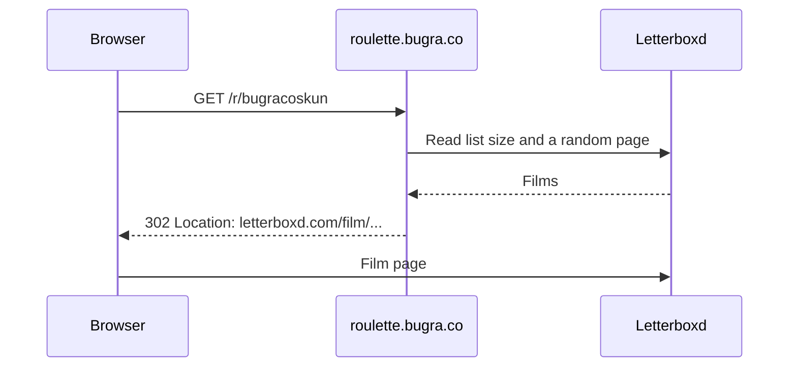

# Direct Redirect (`/r`)

`/r` picks a film on the server and responds with `302 Found` to `https://letterboxd.com/film/<slug>/`. The browser never loads the app.



Responses carry `Cache-Control: no-cache, no-store, must-revalidate`, so a bookmark returns a new film on every visit.

## Routes

| Route | Picks from |
|---|---|
| `/r/<user>` | The user's watchlist |
| `/r/<user>/list/<slug>` | A custom list |
| `/r?url=<a>,<b>` | Several lists combined (up to 5) |
| `/?url=<a>&redirect=1` | Same as `/r`, via the root URL |

## Examples

```text
/r/bugracoskun
/r/official/list/top-250-films
/r/bugracoskun?shuffle=1
/r/bugracoskun/list/top-films?count=1200
/r?url=user1,user2&mode=equal
/r/bugracoskun?format=json
```

All [URL parameters](parameters.md) apply.

## Errors

If a list is private, empty, or missing, `/r` redirects to `/?url=...&error=...` and the app shows the reason instead of a broken page.
